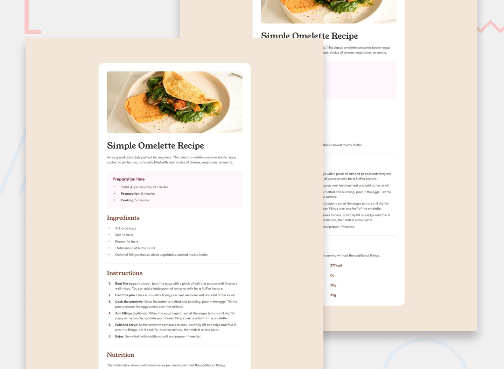
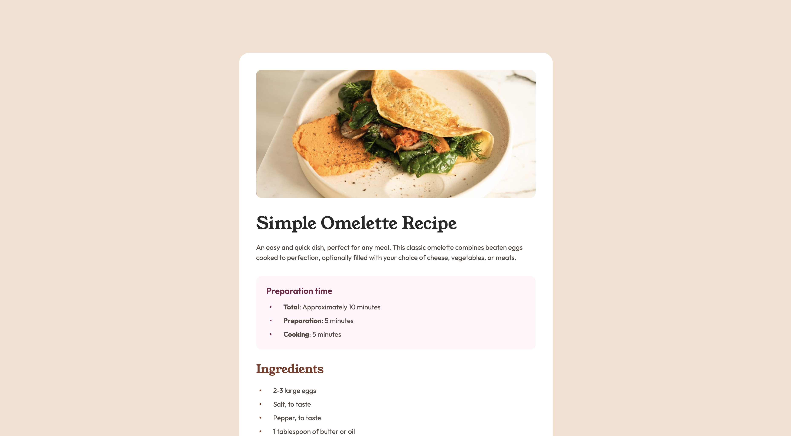

# Frontend Mentor - Recipe page solution

This is a solution to the [Recipe page challenge on Frontend Mentor](https://www.frontendmentor.io/challenges/recipe-page-KiTsR8QQKm).

## Table of contents

- [Overview](#overview)
  - [The challenge](#the-challenge)
  - [Extra feature](#extra-feature)
  - [Screenshot](#screenshot)
  - [Links](#links)
- [My process](#my-process)
  - [Built with](#built-with)
  - [What I learned](#what-i-learned)
  - [AI Collaboration](#ai-collaboration)

## Overview

### The challenge

The challenge is to build out this recipe page and get it looking as close to the design as possible.

### Extra feature

**As a** visitor of the recipe page,<br>
**I want to** see the content appear smoothly when the page opens,<br>
**so that** the page feels polished and easy to follow.

### Screenshot

#### Design preview



#### My solution (desktop)



### Links

- Repository URL: [GitHub Repo](https://github.com/MATBMS/recipe-page)
- Live Site URL: [GitHub Page](https://matbms.github.io/recipe-page/)

## My process

### Built with

- Semantic HTML5 markup
- CSS custom properties
- Flexbox
- Mobile-first workflow

### What I learned

#### CSS counters

I learned how to number the instruction steps with CSS counters instead of the browser's default list numbers, so I can place and style the numbers exactly like the design.

Three properties work together:

- `counter-reset` creates the counter and sets it to 0. It goes on the parent (the `<ol>`).
- `counter-increment` adds 1 to the counter for each list item (`<li>`).
- `counter()` inside `content` prints the current value. It is used in the `::before` pseudo-element of each item.

```css
.steps {
  counter-reset: step;
}

.steps li {
  counter-increment: step;
}

.steps li::before {
  content: counter(step) ".";
}
```

### AI Collaboration

This is a project where I act as the Product Engineer, not the developer. I define the requirements and validate every decision, and Claude Code writes the code.
